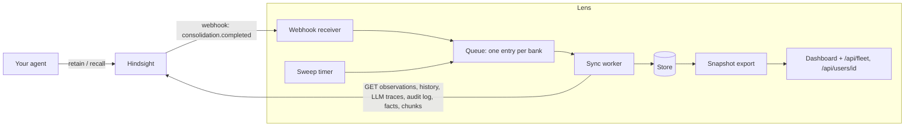

# Hindsight Lens

A read-only sidecar for [Hindsight](https://github.com/vectorize-io/hindsight) that
keeps a durable history of what the memory layer believes about each user, why
each belief changed, and when it was recalled.

Hindsight shows you what it believes *now*. It forgets three things Lens keeps:

| Hindsight | Lens |
|---|---|
| A deleted observation is gone, with its history (404) | The belief stays, marked deleted, with its last wording, the reason, and the facts that caused the delete |
| The reason for a change lives only in the LLM request trace, kept one day by default | The reason is copied onto the version it explains |
| History is capped at 50 entries per observation | Every version is kept |
| Every read endpoint is per bank | One store across all banks, so fleet questions are one query |

Lens never writes to Hindsight and never sits in the retain or recall path. It
attaches to any Hindsight (tested on 0.10.2) with a few settings and no change to
your agent. Each Hindsight bank is one "user" on the dashboard.

## Attach it to your Hindsight

1. Run Lens where it can reach Hindsight's API, and Hindsight can reach it:

   ```bash
   docker run -d --name lens -p 127.0.0.1:8900:8900 -v lens-data:/data \
     -e LENS_HINDSIGHT_URL=http://hindsight:8888 \
     -e LENS_WEBHOOK_SECRET=change-me \
     -e LENS_PASSWORD=choose-one \
     ghcr.io/afif1400/hindsight-lens:latest
   ```

   With Docker Compose, copy the `lens` service from
   [`examples/compose.yml`](examples/compose.yml) into the file that runs Hindsight.

2. Give Hindsight the [settings below](#run-from-source) (webhook, audit log,
   traces) and restart it.
3. Open `http://127.0.0.1:8900/` and sign in as `lens`. The first sweep fills in
   every bank; after that each consolidation pings Lens.

`lens doctor` inside the container (`docker exec lens lens doctor`) checks the
connection and prints the Hindsight settings. Lens keeps memory text: serve it on
a private network behind TLS (see [Endpoints](#endpoints)).

## Architecture



**1. Trigger.** Hindsight posts `consolidation.completed` whenever it has created,
rewritten or deleted observations for a bank. The payload carries counts only, so
the ping is a doorbell: it says *which bank* changed, not *what*. The receiver
verifies the HMAC signature, records the event (deliveries are at-least-once, so
duplicates are recognised), puts the bank on the queue and answers immediately.

**2. Queue and worker.** One worker thread drains the queue, so syncs for a bank
never overlap. Repeated pings for a bank that is already waiting are merged.

**3. Sync** (`lens/sync.py`). Seven steps, each with its own cursor; a step that
fails leaves its cursor alone and is retried on the next sync:

| Step | Reads from Hindsight | Writes |
|---|---|---|
| Beliefs | observations with `updated_at` after the cursor, plus each one's history | `lens_beliefs`, `lens_belief_versions` |
| Reasons | consolidation LLM request traces | `reason` and the triggering facts on each version |
| Deletes | the full id list, only when a ping reported deletes, a trace names one, or the count is off | a `deleted` version (tombstone) |
| Evidence | each supporting fact, the entities Hindsight extracted from it, and the chunk it came from | `lens_evidence` |
| Recalls | audit-log rows for `recall` | `lens_recall_events`, `lens_recall_hits` |
| Portraits | mental models, with content | `lens_portraits` |

A sync is idempotent: versions are keyed by the change's own timestamp, so
running it twice records nothing twice.

**4. Sweep.** A timer enqueues every bank (hourly by default). It is the safety
net for a dropped ping (Hindsight stops retrying after six attempts) and the
thing that harvests reasons before Hindsight's trace retention expires.
`/status` reports how long ago reasons were last harvested; that lag is the one
number to alert on.

**5. Read side.** `lens/export.py` computes everything the screens show (flags,
fleet tiles, weekly series) from the store alone, with one per-user computation.
`GET /api/fleet` returns the Fleet screen's numbers and each user's flags and
counts, with no memory text. `GET /api/users/{bank_id}` returns one user in full.
`GET /` serves the dashboard, which loads the fleet on start and each user when
it is first opened.

### How a reason finds its version

Hindsight's history says a belief changed; only the LLM trace says why. Lens
joins them with three rules, all found the hard way:

- an update or delete is matched by observation id, a create by wording;
- the version must have been written just after the LLM call (within two
  minutes), so a trace left over from a deleted-and-rebuilt bank is never pinned
  on a new belief with the same wording;
- one LLM call explains a version at most once, so two rewrites seconds apart
  each keep their own reason.

### Two clocks

`time_basis=write` (default) dates a change by when Hindsight wrote it.
`time_basis=event` dates it by the newest fact that caused it. They agree in live
use and differ after a backfill, where weeks of conversation are retained in
minutes.

## See it with demo users

No Hindsight needed. From the repository root:

```bash
pip install -e .
lens demo            # http://127.0.0.1:8901/
```

or just open `demo/dashboard-demo.html` in a browser. Five fictional people chat
with a personal assistant for six weeks; their conversations were replayed
through a real Hindsight 0.10.2 with a real model (gpt-oss-20b) and this
collector. Every belief, rewrite, reason and recall on the page is what Hindsight
actually did; only the conversations were written. `demo/` holds the personas,
the brief they were written from, and the scripts to replay and rebuild.

## Run from source

```bash
pip install -e ".[postgres]"        # or without [postgres] for SQLite

export LENS_HINDSIGHT_URL=http://hindsight:8888
export LENS_HINDSIGHT_API_KEY=...            # only if Hindsight requires one
export LENS_DATABASE_URL=postgresql+psycopg://lens:...@db/lens   # default: sqlite:///lens.db
export LENS_WEBHOOK_SECRET=change-me
export LENS_PASSWORD=...                     # the dashboard login; username is `lens` unless LENS_USERNAME is set

lens doctor     # checks Hindsight and prints the settings below
lens serve      # webhook receiver + worker + sweep on :8900
```

Set these on the Hindsight API **and** worker, then restart them:

```bash
HINDSIGHT_API_WEBHOOK_URL=http://<lens-host>:8900/hooks/hindsight
HINDSIGHT_API_WEBHOOK_SECRET=change-me
HINDSIGHT_API_WEBHOOK_EVENT_TYPES=consolidation.completed,retain.completed
HINDSIGHT_API_WEBHOOK_ALLOWED_HOSTS=<lens-host>   # private addresses are refused without this
HINDSIGHT_API_AUDIT_LOG_ENABLED=true              # off by default; recalls are invisible without it
HINDSIGHT_API_LLM_TRACE_RETENTION_DAYS=7          # default 1; this is the reasons' lifetime
```

Worth knowing: audit rows hold every recall's full response and are kept forever
by default. Once Lens is copying what it needs, set
`HINDSIGHT_API_AUDIT_LOG_RETENTION_DAYS` and consider
`HINDSIGHT_API_AUDIT_LOG_ACTIONS=recall`.

Other commands: `lens sync [--bank ID] [--reconcile]`, `lens inspect --bank ID`, `lens forget BANK [--yes]`, `lens demo`.

| Setting | Default | Meaning |
|---|---|---|
| `LENS_USERNAME` | lens | Login name for the dashboard, snapshot API and manual sync |
| `LENS_PASSWORD` | unset | Their password. Unset = those routes answer 503 while collection keeps running |
| `LENS_SWEEP_INTERVAL_SECONDS` | 3600 | How often every bank is re-checked |
| `LENS_FETCH_SOURCE_TEXT` | true | Copy the chunk each fact came from |
| `LENS_SOURCE_TEXT_MAX_CHARS` | 4000 | Cap on that copy |
| `LENS_CURSOR_OVERLAP_SECONDS` | 10 | Re-read window behind each cursor |
| `LENS_PORT` / `LENS_HOST` | 8900 / 0.0.0.0 | Where the receiver listens |

## Endpoints

| | |
|---|---|
| `GET /` | The dashboard (login) |
| `GET /api/fleet?time_basis=write\|event` | Fleet numbers, trends, each user's flags and counts; no memory text (login) |
| `GET /api/users/{bank_id}?time_basis=write\|event` | One user in full; 404 if Lens holds no such bank (login) |
| `POST /sync/{bank_id}?reconcile=true` | Queue a sync by hand (login) |
| `POST /hooks/hindsight` | Hindsight's webhook target (open, verified by Hindsight's signature) |
| `GET /status` | Last ping, reason-harvest lag, queue depth, counts (open, no memory text) |
| `GET /healthz` | Liveness (open) |

**The store and the dashboard hold users' memory text.** The routes marked
"login" use HTTP Basic: the browser shows its own sign-in prompt, realm
"Hindsight Lens". Basic sends the password with every request, so serve Lens
only behind a proxy that terminates TLS, on a private network. Lens itself
speaks plain HTTP. FastAPI's `/docs` and `/openapi.json` are switched off; this
table is the API reference.

### The access record

Every guarded request leaves a row in `lens_access_log` before any data
leaves Lens: `view_fleet`, `view_user` and `sync` with the signed-in name and
the bank they exposed, and `denied` with the name tried at a rejected sign-in.
`detail` holds the source address, the proxy's `X-Forwarded-For`, the method
and the path; never memory text, never a password. If the row cannot be
written, the request answers 503 and returns nothing. Lens only ever appends
to this table and keeps rows indefinitely; to enforce that on Postgres, revoke
`UPDATE` and `DELETE` on `lens_access_log` from Lens's database role. Opening
the dashboard page itself is not recorded: the page holds no data until it
asks for the fleet or a user. A request with no credentials at all, the
browser's first one before its sign-in prompt, is not a rejected sign-in and
leaves no row. A name that matches the password is stored as empty. Each rejected
sign-in costs one small row (names, bank and path are capped), so anyone who
can reach Lens can grow this table: rate-limit failed sign-ins at the proxy.

Who read this user's memory, and when:

```sql
SELECT at, username, action, detail
FROM lens_access_log
WHERE bank_id = 'user-123' AND action IN ('view_user', 'sync')
ORDER BY at DESC;
```

Rejected sign-ins in the last day, by source:

```sql
SELECT detail->>'source' AS source, username, count(*)
FROM lens_access_log
WHERE action = 'denied' AND at > now() - interval '1 day'   -- Postgres
GROUP BY 1, 2;
```

## Erasure

Lens's copy never outlives Hindsight's. When a user's bank is deleted in
Hindsight, Lens erases every row it holds for that bank: its state, beliefs
(including the tombstones of beliefs Hindsight deleted, which Lens otherwise
keeps), versions and reasons, evidence and source text, recalls, portraits and
webhook events. One transaction does it and writes an `erase` row to the access
record with the trigger and per-table counts. If that row cannot be written,
nothing is erased. Access rows for the bank stay: they hold its id, never its
memory. A bank created again later with the same id starts from nothing.

**The sweep** erases a bank only when both hold: a complete bank listing
(every page read, matching its own total) lacks it, and the bank then answers
Hindsight's own `404 {"detail": "Bank '<id>' not found"}`. A failed or partial
listing, a timeout, any other error, or a 404 in another shape erases nothing;
the sweep logs a warning and `/status` counts it in `last_sweep_warnings`. It
also erases nothing when the listing is empty or more than half the banks Lens
holds are gone at once: that is what pointing Lens at a fresh or different
Hindsight looks like. Erase those deliberately with `lens forget`. A sync asked
for after erasure (a late webhook, a manual sync) can leave an empty bank row
behind; the next sweep removes it.

**`lens forget BANK`** erases at once. It refuses while Hindsight still holds
the bank or cannot say, asks before erasing unless `--yes` is given, and prints
the counts. The access row names the operator as `cli:<os user>`.

**Hindsight keeps more than the bank.** Deleting a bank in Hindsight 0.10.2
leaves that bank's LLM request traces behind; they hold the text of the user's
facts and beliefs until trace retention expires, and a bank created again with
the same id sees them. Set `HINDSIGHT_API_LLM_TRACE_RETENTION_DAYS` to cover
the longest Lens outage you plan for and no longer: Lens copies reasons at
every sweep, so retention past that only keeps user text around.

## Develop

```bash
pip install -e ".[dev]"
pre-commit install      # ruff check and format on every commit
pytest                  # set LENS_TEST_DATABASE_URL=postgresql+psycopg://... to run against Postgres
```

CI runs ruff and the suite on SQLite and Postgres for every push to `master` and every pull request,
and builds the image (amd64 and arm64). Pushes to `master` publish `ghcr.io/afif1400/hindsight-lens:latest`;
a `v*` tag publishes that version.

### The dashboard

`lens/dashboard.html` is built from `web/` (React, the free AlignUI components, Tailwind,
Inter) into one self-contained file, committed so that running Lens needs no Node:

```bash
cd web && pnpm install && pnpm build     # format check, typecheck, tests, then ../lens/dashboard.html
pnpm test                                # the list, redline, entity and session logic
LENS_DEV_URL=http://127.0.0.1:8900 pnpm dev   # live reload against a running Lens
```

CI rebuilds it and fails if the committed file differs from `web/`. Lens serves it at `/`
behind the login; it reads only `/api/fleet` and `/api/users/{id}`, loads each user once,
and keeps the open item in the URL (`#/u/<bank>/belief/<id>`). Every word on it is
Hindsight's: no model runs in Lens, and the belief filters are Hindsight's own entities.

Stores written by an older Lens gain new columns on start, and the next sync fetches each
held fact once more to pick up its entities.

## What was verified

Against Hindsight 0.10.2:

- `tests/` (87 tests): the real client and sync logic against an in-memory
  Hindsight that answers with shapes captured from a live server. Passes on
  SQLite and on Postgres (`LENS_TEST_DATABASE_URL`).
- `e2e/`: a real `hindsight-api` process with embedded Postgres, configured as
  above, driving the collector through its real global webhook. Covers create,
  two rewrites seconds apart, delete, recall, signature checking.
- `demo/`: five fictional users, 46 sessions, replayed through a real
  Hindsight with a real model (gpt-oss-20b via OpenRouter).

In `e2e/` Hindsight's LLM is scripted, so it proves the plumbing; `demo/` shows
what a real model does with it.

## Known limits

- One worker, one bank at a time. Fine for hundreds of banks; a large fleet
  needs a worker pool with a per-bank lock.
- `export.py` loads the whole store into memory. Past tens of thousands of
  beliefs the fleet numbers should become SQL.
- Offset pagination against a changing listing can skip a row; the cursor
  overlap and the sweep cover it.
- A belief created *and* deleted between two syncs is never seen.
- Whether a recalled belief shaped the agent's reply is unknowable from
  Hindsight; that needs a hook in the agent.
- The "many changes" flag counts rewrites. It cannot tell a belief being
  refined from one being reversed.
- Not tested on Hindsight Cloud.

## License

MIT. The dashboard includes components from [AlignUI](https://alignui.com) (MIT).
